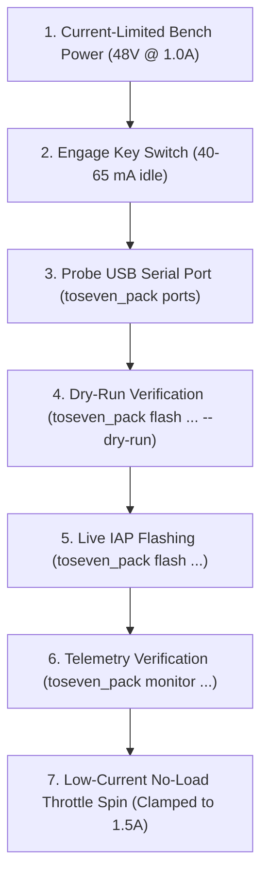

# ToSeven DM01 / DM02 Hardware Bench Testing & Bring-up Runbook

## 1. Overview & Safety Rules

This runbook defines the official pre-flight bench testing protocol for **ToSeven DM01 (1000W / 750W)** and **DM02 (500W)** mid-drive motor controllers and displays prior to on-bike installation.

> [!CAUTION]
> ### CRITICAL SAFETY WARNING: BENCH TEST ONLY
> **OPEN-SOURCE FIRMWARE MUST NOT BE INSTALLED ANYWHERE OTHER THAN A CONTROLLED BENCH TEST.**
> Do NOT install open-source firmware on an assembled bicycle or attempt to ride with it at this stage. Open-source firmware is strictly intended for isolated bench bring-up, phase verification, and current-clamped diagnostics.
>
> **Bench Power Safety Rules:**
> 1. **Never use a high-discharge e-bike lithium battery for initial bench flashing.** E-bike batteries can deliver >100A instantly during a fault, vaporizing PCB traces and silicon. Always use a current-limited DC bench power supply.
> 2. **Current Limit Clamped to 1.0A:** During flashing and logic verification, strictly clamp the bench supply to **1.0A at 48.0V** (or 52.0V). Idle controller logic consumes only ~40–60 mA. A 1.0A clamp prevents MOSFET destruction in the event of phase shoot-through or improper gate drive.
> 3. **3.3V Logic Levels Only:** The Cortex-M4F controller UART lines operate at **3.3V TTL**. Connecting a 5V UART adapter directly or shorting to VBat will immediately destroy the MCU's USART3 transceiver pins.

---

## 2. Hardware & Tool Requirements

1. **Adjustable DC Bench Power Supply:** 0–60V, minimum 0–3A, with Constant Voltage (CV) and Constant Current (CC) limiting.
2. **USB-to-UART Serial Adapter:** High-speed FTDI (FT232R/FT232H), CP2102, or CH340 with **3.3V logic level jumper set**.
3. **ToSeven Programming Harness:**
   - 5-pin Julet/Higo connector (female) branching to USB-UART (TX, RX, GND) and power toggle (VBat, Key).
   - Or a test breakout clip connected to the main display harness.
4. **Digital Multimeter:** For measuring logic rail voltages and verifying zero ohms to ground.
5. **Host Computer:** Running macOS, Linux, or Windows with `toseven_pack` CLI and `DM+ Firmware Studio` GUI.

---

## 3. Wiring & Harness Pinout

### 5-Pin Display Connector Pinout (Julet / Higo Mini-B)
Looking into the connector face:

```
        Top Notch
       ┌─────────┐
    1 (●)       (●) 2
   3 (●)         (●) 4
         (●) 5
       └─────────┘
```

| Pin | Wire Color | Signal Name | Description | Bench Connection |
| :--- | :--- | :--- | :--- | :--- |
| **1** | Red | **VBat** | Full Battery Voltage (36V–58.8V) | Bench Supply **Positive (+)** |
| **2** | Blue / Orange | **Lock / Key-In** | Power Enable / Ignition line | Connected to **VBat** via SPST Toggle Switch |
| **3** | Black | **GND** | System Ground & Common Reference | Bench Supply **Negative (-)** AND USB-UART **GND** |
| **4** | Green | **Controller TX** | 3.3V UART Output from Controller | USB-UART **RXD** pin |
| **5** | Yellow | **Controller RX** | 3.3V UART Input to Controller | USB-UART **TXD** pin |

> [!WARNING]
> **Common Ground Reference:** Ensure the USB-UART **GND** is tied directly to Pin 3 (**GND**). Do NOT float the serial ground reference, or UART framing errors will occur.

---

## 4. Bench Power Supply Setup

1. **Preset Supply Before Connecting:**
   - Turn on the bench power supply with output **disabled**.
   - Set Voltage: **48.0 V** (or 52.0 V if testing a 14S setup).
   - Set Current Limit: **1.0 A** max.
2. **Verify Polarization:**
   - Confirm Red lead connects to Pin 1 (VBat).
   - Confirm Black lead connects to Pin 3 (GND).
   - Leave the Key toggle switch **OFF** (open).
3. **Enable Supply Output:**
   - Turn output ON. Current draw should be **0.000 A** with Key switch open.
4. **Engage Key Switch:**
   - Close the Key toggle switch (connecting Pin 2 to Pin 1).
   - Expected current draw: **40 mA to 65 mA** at 48.0V as the internal buck converter initializes and powers the Cortex-M4F MCU.
   - If current immediately hits the **1.0A limit**, immediately disconnect — this indicates a short circuit on the VBat line or a blown primary buck inductor.

---

## 5. Step-by-Step Bring-up & Verification Procedure



### Step 1: Detect Serial Adapter
Plug in the USB-UART adapter and list available ports:
```bash
cargo run --manifest-path dm01-firmware/Cargo.toml --bin toseven_pack -- ports
```
Expected output:
```
Detected 1 serial port(s):
  [1] /dev/tty.usbserial-110 (USB-Serial Controller)
```

### Step 2: Validate Firmware Container
Before flashing, verify the `.Pack` file integrity and vector table:
```bash
# Verify Open Firmware container
cargo run --manifest-path dm01-firmware/Cargo.toml --bin toseven_pack -- info build/TO7-DM01-OpenFirmware-v0.3.0.Pack
```
Expected output:
```
ToSeven .Pack Firmware Container:
  Target Device:      DM01 Mid-Drive Motor Controller (ID: 0x00196EA4)
  Target Rating:      External 12-FET Inverter (750W / 1000W)
  Flash Load Address: 0x08001800
  Initial MSP:        0x20005628
  Reset Handler:      0x08001A51
  Header Key:         0xA8
  Payload Key:        0x67
  Payload Size:       57,708 bytes
  Status:             Valid Cortex-M4F Vector Table & Checksums OK
```

### Step 3: Dry-Run Handshake & Sector Simulation
Run a safe dry-run simulation that validates the handshake packet encoding and sector chunking:
```bash
# Via CLI:
cargo run --manifest-path dm01-firmware/Cargo.toml --bin toseven_pack -- flash /dev/tty.usbserial-110 build/TO7-DM01-OpenFirmware-v0.3.0.Pack --dry-run

# Or via DM+ Firmware Studio GUI:
Click [ Test Flash (Dry Run) ]
```

### Step 4: Live IAP Firmware Flashing
Execute the live hardware flash:
```bash
# Via CLI:
cargo run --manifest-path dm01-firmware/Cargo.toml --bin toseven_pack -- flash /dev/tty.usbserial-110 build/TO7-DM01-OpenFirmware-v0.3.0.Pack

# Or via DM+ Firmware Studio GUI:
Click [ Flash Firmware ]
```
Expected sequence:
1. Flasher listens at 38400 Baud (vendor factory default, with 115200 fallback) for bootloader `IDENT` (`0x02, 0xFD` or `0x06`).
2. If in application mode, flasher transmits 21-byte encrypted wakeup frame at 9600 Baud (`0xC9, 0x77`, 7-bit encoded, `UartMask` high/low nibbles, ToSeven CRC-16, `0x69` cipher) and asserts DTR reset.
3. Flasher transmits `0x06` ACK, pauses 10 ms, and transmits 12-byte header frame (size, sum, `UartMask`, baud rate index), receiving `0x06` ACK.
4. Flasher streams payload in 16-byte chunks masked with Tier 2 wire stream XOR cipher (`b ^ UartMask`), receiving `0x06` ACK every 1024-byte (1 KB) sector.
5. Controller bootloader verifies cumulative 32-bit byte sum against Flash memory (`0x04` EOT on match; `0x15` NAK on failure) and automatically restarts into the application.

### Step 5: Live Telemetry Verification
After flashing completes, the controller begins broadcasting 18-byte telemetry frames at 9600 Baud:
```bash
cargo run --manifest-path dm01-firmware/Cargo.toml --bin toseven_pack -- monitor /dev/tty.usbserial-110 --baud 9600
```
Expected output:
```
[MONITOR] Listening on /dev/tty.usbserial-110 (9600 Baud, XOR 0x69 cipher)...
Frame #001: 48.1 V | 0.0 A (0 W) | Temp: 24.2 °C | Speed: 0.0 km/h | Cadence: 0 RPM | Faults: None [OK]
Frame #002: 48.1 V | 0.0 A (0 W) | Temp: 24.2 °C | Speed: 0.0 km/h | Cadence: 0 RPM | Faults: None [OK]
```

### Step 6: 3-Pillar Pre-Flight Verification (Before Applying Power to Inverter)

Before connecting motor phase leads or attempting to spin the motor under power, verify the **three foundational pillars** of motor control:

```
[Phase A: Quiescent Current] ──> [Phase B: Shunt Auto-Zero] ──> [Phase C: Hand-Spin Hall Check]
                                                                        │
                                                                        ▼
[Phase E: Gate Driver Dead-Time] <── [Phase D: 1.0A Clamped Spin Test] <─┘
```

#### Phase A: Quiescent Logic Current & Power Rail Check
1. Power supply set to **48.0 V**, strictly clamped to **1.0 A**.
2. Close Key switch.
3. Observe power supply display:
   - **Normal:** 40 mA to 65 mA (internal buck converter running, MCU active).
   - **Fault (>150 mA or 1.0 A clamp):** Cut power immediately. Check for shorted gate drivers or shorted 3.3V rail.

#### Phase B: Shunt Auto-Zero Verification
At startup, `calibrate_shunts()` synchronously averages 256 injected ADC conversions while MOSFETs remain in High-Z (0A):
1. In `monitor`, verify that reported phase current is **0.0 A**.
2. The stationary resting bias on both Phase A (`PA6`) and Phase B (`PA5`) shunts must settle between **1700 and 2400 counts** (nominal midpoint is 2048 counts = 1.65 V on 12-bit ADC).
3. If an ADC offset error or floating shunt is detected, the firmware leaves the inverter in High-Z.

#### Phase C: Hand-Spin Hall Sensor & Cadence Verification
With the power supply still clamped to 1.0 A and throttle at zero:
1. **Rotate the motor axle / chainring slowly by hand in the forward direction.**
2. In the telemetry monitor, observe that:
   - Cadence and wheel speed register smoothly without spikes.
   - Fault flags remain **None**. If a Hall disconnect (`0b000` or `0b111`) occurs, the firmware immediately flags an emergency cutoff.
3. The 3 physical Hall sensors on `PB6, PB7, PB8` must transition through the standard 120° Gray code forward sequence:
   $$1 \;\rightarrow\; 3 \;\rightarrow\; 2 \;\rightarrow\; 6 \;\rightarrow\; 4 \;\rightarrow\; 5 \;\rightarrow\; 1$$

#### Phase D: Low-Current No-Load Throttle Spin (Strictly 1.0 A Clamp)
1. Keep the bench power supply strictly clamped to **1.0 A at 48.0 V**.
2. Apply very gentle throttle (5% to 10% deflection, ~1.2 V).
3. **Observation:**
   - **Normal:** Motor turns smoothly, quietly, and accelerates up to low RPM. Current draw should be **0.2 A to 0.5 A**.
   - **Misaligned Hall / Phase Swap:** The motor will hum or vibrate without rotating, and the bench supply will immediately hit the 1.0 A current limit and fold back voltage. Because current is clamped to 1.0 A, **no damage occurs**. Release throttle immediately. Swap any two motor phase wires (e.g. Blue and Yellow) or adjust `angle_offset_deg` in the configuration.
4. Once smooth low-speed rotation is confirmed, increase throttle gradually. No-load full-speed current should settle between **0.8 A and 1.4 A** at 48 V.

#### Phase E: Gate Driver Dead-Time & Bootstrap Verification
1. Verify that `TIM1->BDTR.DTG = 100` (~1.38 µs hardware dead-time) is active.
2. The SVPWM duty cycle is strictly clamped to **[6.0%, 94.0%]**. The low-side MOSFET is guaranteed to conduct for at least 3.75 µs per 16 kHz cycle, keeping the high-side bootstrap capacitors fully charged.

---

## 6. Architecture Comparison: Factory V6510C vs. VESC vs. DM+

To understand how our low-level motor control implementation compares with other major open-source firmware architectures (such as Benjamin Vedder's VESC and Casainho/Stancecoke's TSDZ2/Kunteng firmwares):

| Subsystem | Stock Factory (`V6510C`) | VESC (Vedder ESC) | DM+ Open Firmware (`dm01-firmware`) |
| :--- | :--- | :--- | :--- |
| **Math Precision** | Hardware single-precision `f32` (FPU) at `0x0800D3C0` | Hardware single-precision `f32` (`mcpwm_foc.c`) | Fixed-point Q15 + hardware `f32` FPU parity (`compute_svpwm_v6510c_f32`) |
| **Current Sampling** | Dual low-side shunts (`PA6` / `PA5`) triggered by TIM1 valley TRGO | Dual or triple shunts triggered by timer update event | Dual low-side shunts (`PA6` / `PA5`) synchronized to TIM1 center TRGO |
| **Shunt Calibration** | 256 startup samples averaged in High-Z (`0x08009A6C`) | `mcpwm_foc_calibrate_offsets()` multi-sample average in High-Z | Exact 256-sample startup average programming `ADC1->JOFR1` / `ADC2->JOFR1` |
| **Rotor Tracking** | 6-sector Hall table with PLL velocity step (`0x08004450`) | BEMF observer + Hall table interpolation (`m_hall_table[8]`) | 120° Gray code Hall observer + PLL step tracker with 100ms standstill decay |
| **Modulation** | 7-segment Space Vector PWM with min-max common mode | 7-segment Space Vector Modulation (SVM Mode 1/2) | 7-segment Space Vector PWM with min-max neutral saddle injection |
| **Dead-Time Margins** | Hard clamp to $[6.0\%, 94.0\%]$ (`0x080072BA`) | Configurable max modulation clamp (`max_duty = 0.95`) | Hard clamp to $[6.0\%, 94.0\%]$ ($ARR = 5999$) guaranteeing bootstrap refresh |
| **Anti-Windup** | Clamped PI integrator saturation | Integrator clamping on voltage limits | Clamped integral saturation with immediate recovery on error reversal |

---

## 7. Display Bench Flashing & ISP Lockout Bypass

ToSeven displays (`T24V`, `T154`, `LCD135C`, `M15`) use a MegaHunt MH1903/MH2020C microcontroller equipped with an internal USB CDC ISP bootloader:

1. **Connect Display over USB:**
   - Plug the display directly into the host computer via its USB-C port.
   - Hold the **Power + Down** buttons while plugging in to force ISP bootloader mode.
   - The device will enumerate as `/dev/tty.usbmodem*` (macOS/Linux) or `COM*` (Windows).
2. **Inspect and Neutralize Lockout Gates:**
   ```bash
   # Inspect model and lockout status
   cargo run --manifest-path dm01-firmware/Cargo.toml --bin toseven_pack -- display info blobs/displays/t24v/TO7-T24V-Y241225.hex

   # Permanently patch lockout branch gates
   cargo run --manifest-path dm01-firmware/Cargo.toml --bin toseven_pack -- display patch blobs/displays/t24v/TO7-T24V-Y241225.hex build/TO7-T24V-Unlocked.hex
   ```
3. **Flash Display with Auto-Unlock:**
   ```bash
   cargo run --manifest-path dm01-firmware/Cargo.toml --bin toseven_pack -- display flash /dev/tty.usbmodem110 blobs/displays/t24v/TO7-T24V-Y241225.hex --unlock
   ```

---

## 8. Troubleshooting & Recovery

| Symptom | Probable Cause | Corrective Action |
| :--- | :--- | :--- |
| **No serial response / Timeout waiting for IDENT** | RX/TX reversed or baud rate mismatch | Swap USB-UART RX and TX. Verify Ground pin is connected. Power cycle controller using Key switch while flasher is probing. |
| **Current immediately hits 1.0A clamp on power-up** | Reverse polarity or shorted VBat rail | Cut power immediately. Check harness wiring with DMM. Verify resistance between Pin 1 and Pin 3 exceeds 10 kΩ. |
| **Telemetry receives framing errors / garbage bytes** | Unconnected GND or baud rate mismatch | Verify baud rate is 9600 Baud for telemetry (flasher uses 115200 Baud). Confirm USB-UART GND is firmly soldered to Pin 3. |
| **Flash completes but motor does not turn** | Brake cutoff engaged or throttle voltage out of range | Check telemetry frame fault flags in `monitor`. Ensure brake sensors are disconnected or normally open. |
| **Total bootloader brick (no IDENT after interrupted flash)** | Flash vector table corrupted | The ToSeven hardware bootloader resides in protected ROM (`0x1FFFD800` or `0x08000000..0x080017FF`) and cannot be erased by IAP writes. Power cycle the Key switch while launching `toseven_pack flash` to catch the initial ROM boot sequence. |
